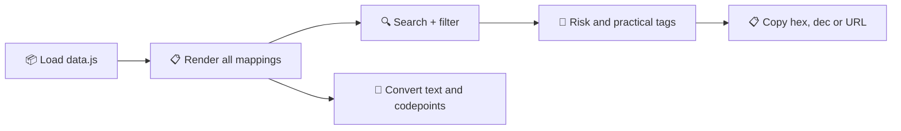

# 🔣 Unicode Confusables Explorer

**Search, filter and copy Unicode confusable characters, ready for payload testing.**
A single-page, zero-install helper for bug bounty hunters and pentesters.

 

<!-- Replace with a screenshot of the tool -->

[What is it?](#-what-is-it) · [How it works](#%EF%B8%8F-how-it-works) · [Features](#-features) · [Usage](#-usage) · [Risk levels](#-risk-levels) · [Project structure](#%EF%B8%8F-project-structure) · [Responsible use](#%EF%B8%8F-responsible-use)

---

## 💡 What is it?

Some Unicode characters look like, or normalize to, plain ASCII characters. Finding the right one for a filter bypass test means digging through long mapping tables by hand. **Unicode Confusables Explorer** puts the UTS #39 confusables data (version 18.0.0) in one searchable page.

Search by name, codepoint, hex, decimal or the character itself. Every row shows the source character, the ASCII or Unicode target it maps to, and its encodings, with buttons to copy them.

It only displays and converts data in your browser. It doesn't scan or test anything.

## ⚙️ How it works

## ✨ Features

| | |
|---|---|
| 📋 **All mappings table** | Each row shows the character, its target, hex and decimal codepoint, UTF-8 percent-encoding, HTML entity and URL form. |
| 🔍 **Flexible search** | Match on name, codepoint (`002E`), hex, decimal or the character itself. |
| 🎯 **Target filter** | A dropdown limits the table to one target character or name. |
| ⚡ **Practical mode** | One toggle hides most of the noise and keeps the ranges that matter for testing. |
| 🏷️ **Quick chips** | One-click filters for Full Stop, Semicolon, Slash, Backslash, Space, Apostrophe, Quote and Backtick. |
| 🚦 **Risk rating** | Every row is tagged `high`, `medium` or `low`. Click the **Risk** header to sort. |
| 📎 **Bulk copy** | Copy all visible hex, decimal or URL values at once from the column headers. |
| 🔄 **Converters** | Character to Unicode, Unicode to character, and full strings in both directions. |
| 📦 **Zero dependencies** | Static files only. No build step, no backend, no install. |

---

## 🚀 Usage

1. Download the repo and keep the `normalization/` folder next to `confusables.html`
2. Open `confusables.html` in any modern browser

**Then:**

1. Type in the search box, or click a chip such as **Slash** or **Apostrophe**
2. Toggle **⚡ Practical** to cut down the list
3. Use the **Copy** buttons in a row (`URL` or `HEX`), or the column headers to copy everything visible

**Converters** (the **🔄 Char ↔ Unicode** tab):

- **Character → Unicode:** paste one or more characters to get hex, decimal, UTF-8 / URL and HTML values
- **Unicode → Character:** enter `002E`, `46` or `U+00B7`
- **Convert full string:** switch between **Text → Unicode** and **Unicode → Text**. Codepoints can be separated by spaces, commas or newlines, and written as `U+XXXX`, `0xXXXX` or decimal

> 💡 If the page shows a warning that `data.js` was not found, check that `normalization/data.js` is in place.

---

## 🚦 Risk levels

| Level | Unicode ranges |
|---|---|
| 🔴 **high** | Fullwidth and halfwidth forms, small form variants, general punctuation, supplemental punctuation, CJK symbols and punctuation, alphabetic presentation forms |
| 🟡 **medium** | Greek, Cyrillic, Armenian, Hebrew, Arabic, Indic scripts, Thai, Lao, Georgian, Ethiopic, Khmer, Latin Extended Additional |
| ⚪ **low** | Everything else |

The rating is based on the Unicode block of the source character. It is a rough guide, not a verdict.

---

## 🗂️ Project structure

| File | Purpose |
|---|---|
| `confusables.html` | The page |
| `normalization/app.js` | Table, search, filters, copy and converter logic |
| `normalization/data.js` | The confusables mappings (`window.CONFUSABLES_DATA`) |
| `normalization/style.css` | Dark UI styling |

---

## 🔒 Privacy

- The page runs entirely in your browser
- The script makes no network requests

---

## ⚖️ Responsible use

This tool is for authorized security research and bug bounty work. Only test targets that are **in scope** for a program you're participating in, or that you have permission to test.

Built for hunters who read code before they read headers. 🔣

